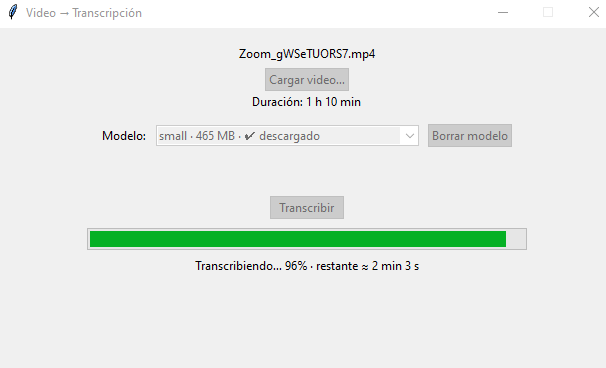

# 🎙️ Transcriptor de video

Programa de escritorio con interfaz gráfica que convierte el audio de un video en un archivo `.txt` con la transcripción. Funciona **100 % local**: no usa APIs ni cuentas, y el video nunca sale de tu computadora. Solo necesita internet la primera vez, para descargar el modelo de reconocimiento de voz.



## ✨ Características

- Interfaz simple: cargás un video, elegís un modelo y tocás **Transcribir**.
- Formatos soportados: `.mp4`, `.mkv`, `.avi`, `.mov`, `.webm` (y cualquiera que lea FFmpeg).
- **Selector de modelo** que indica el tamaño y si ya está descargado.
- **Borrado de modelos** desde la interfaz para liberar espacio en disco.
- **Estimación del tiempo** según la duración del video y el modelo elegido, que se actualiza al cambiar cualquiera de los dos.
- **Barra de progreso real** con tiempo restante.
- **Autocalibración:** después de cada transcripción, la estimación se ajusta a la velocidad de tu equipo.
- Detección automática del idioma.
- Instalación automática de dependencias.

## 📋 Requisitos

- **Python 3.10 a 3.13** (recomendado 3.12). En Windows, marcá *"Add Python to PATH"* al instalarlo.
- Entre 1 y 4 GB de espacio libre, según el modelo que uses.
- Conexión a internet solo para la primera descarga de cada modelo.
- **No necesitás GPU.** Funciona en CPU.

## 🚀 Instalación y uso

1. Descargá o cloná el repositorio:
   ```
   git clone https://github.com/JDMino/transcriptor.git
   cd transcriptor
   ```
2. Ejecutá el programa:
   - **Windows:** doble clic en `iniciar.bat`
   - **Linux / macOS:** `python3 iniciar.py`

La primera ejecución crea un entorno virtual e instala las dependencias solo (tarda unos minutos). Las siguientes abren la aplicación directamente.

### Uso paso a paso

1. Tocá **Cargar video…** y elegí el archivo.
2. Elegí un modelo en el desplegable. Verás una estimación del tiempo.
3. Tocá **Transcribir**. Si el modelo no está descargado, se baja automáticamente.
4. Al terminar, el archivo `.txt` queda **junto al video**, con el mismo nombre.

## 🧠 Modelos

Usa [faster-whisper](https://github.com/SYSTRAN/faster-whisper), una implementación optimizada de Whisper (OpenAI).

| Modelo     | Tamaño aprox. | Velocidad  | Calidad                             |
|------------|---------------|------------|-------------------------------------|
| `tiny`     | 75 MB         | Muy rápida | Básica, falla bastante en español   |
| `base`     | 145 MB        | Rápida     | Aceptable con audio limpio          |
| `small`    | 465 MB        | Media      | Buen equilibrio (recomendado)       |
| `medium`   | 1,5 GB        | Lenta      | Muy buena                           |
| `large-v3` | 3 GB          | Muy lenta  | La mejor                            |

Los modelos se descargan **una sola vez** y quedan en la caché de Hugging Face:

- Windows: `C:\Users\<usuario>\.cache\huggingface\hub`
- Linux / macOS: `~/.cache/huggingface/hub`

Podés borrarlos desde el botón **Borrar modelo** de la aplicación, o eliminando a mano la carpeta `models--Systran--faster-whisper-<nombre>`.

## ⏱️ Sobre la estimación de tiempo

El tiempo de transcripción depende de la **duración** del video, no de su peso en MB. La aplicación calcula:

```
tiempo estimado = duración del video × factor del modelo
```

Los factores iniciales son valores genéricos y pueden errar bastante. Después de cada transcripción se ajustan con el tiempo real medido y se guardan en `~/.transcriptor_factores.json`. Para reiniciar la calibración, borrá ese archivo.

## ⚙️ Cómo funciona

- **Interfaz:** `tkinter` (incluido con Python).
- **Transcripción:** `faster-whisper`, en CPU con cuantización `int8`.
- **Decodificación de audio/video:** `PyAV`, que trae FFmpeg incluido (no hace falta instalarlo aparte).
- **Hilos:** la transcripción corre en un hilo separado para que la ventana no se congele.
- **Lanzador (`iniciar.py`):** crea el entorno virtual, instala `requirements.txt` si hace falta y abre la aplicación.

## 🗂️ Estructura del proyecto

```
transcriptor/
├── transcriptor.py      # Aplicación principal
├── iniciar.py           # Lanzador: crea el venv e instala dependencias
├── iniciar.bat          # Acceso directo para Windows
├── requirements.txt     # Dependencias
├── docs/
│   └── captura.png      # Captura para el README
├── .gitignore
└── README.md
```

## 🛠️ Solución de problemas

**`open() got an unexpected keyword argument 'metadata_errors'`**
PyAV 19 eliminó un argumento que `faster-whisper` todavía usa. El proyecto fija `av<19` en `requirements.txt`. Si te pasa igual:
```
pip install "av<19"
```
Se podrá quitar ese límite cuando `faster-whisper` publique soporte para PyAV 19.

**Falla la instalación de dependencias**
Es habitual con versiones de Python muy recientes, para las que algunos paquetes todavía no tienen versión precompilada. Instalá Python 3.12 o 3.13, borrá la carpeta `venv` y volvé a ejecutar `iniciar.bat` o `iniciar.py`.

**`No module named 'tkinter'` (Linux)**
```
sudo apt install python3-tk
```

**Es muy lenta**
Probá con un modelo más chico (`base` o `tiny`). Con una GPU NVIDIA y los drivers CUDA instalados, podés cambiar en `transcriptor.py`:
```python
WhisperModel(nombre, device="cuda", compute_type="float16")
```

**Transcribe en el idioma equivocado**
En la llamada a `transcribe(...)` dentro de `transcriptor.py` agregá, por ejemplo, `language="es"`.

**No encuentro dónde se guardó el modelo**
Puede que tengas definida la variable de entorno `HF_HOME` o `HF_HUB_CACHE`, que cambia la ubicación de la caché.

## 📦 Generar un ejecutable (.exe)

Para distribuirlo a personas que no tienen Python:
```
pip install pyinstaller
pyinstaller --onefile --windowed transcriptor.py
```
El ejecutable queda en `dist/`. Tené en cuenta que es un archivo grande, que el modelo se descarga aparte en la primera ejecución, y que algunos antivirus suelen marcar como sospechosos los ejecutables creados con PyInstaller.

## 🧹 Desinstalar

1. Borrá la carpeta del proyecto (incluye el `venv`).
2. Borrá los modelos descargados (ver sección *Modelos*).
3. Opcional: borrá `~/.transcriptor_factores.json`.

## 📄 Licencia

Elegí la licencia que prefieras (por ejemplo, MIT) y agregá un archivo `LICENSE`.

## 🙏 Créditos

- [faster-whisper](https://github.com/SYSTRAN/faster-whisper) (SYSTRAN)
- [Whisper](https://github.com/openai/whisper) (OpenAI)
- [PyAV](https://github.com/PyAV-Org/PyAV)
